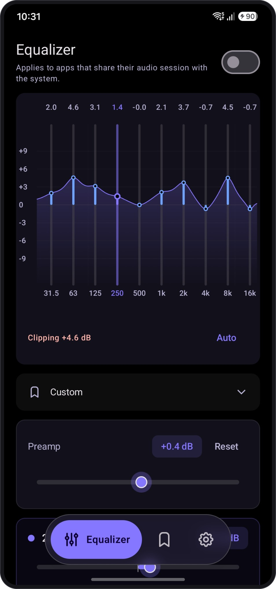
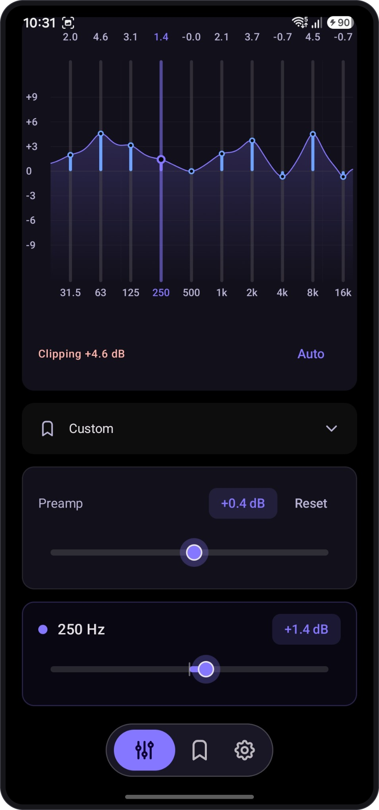
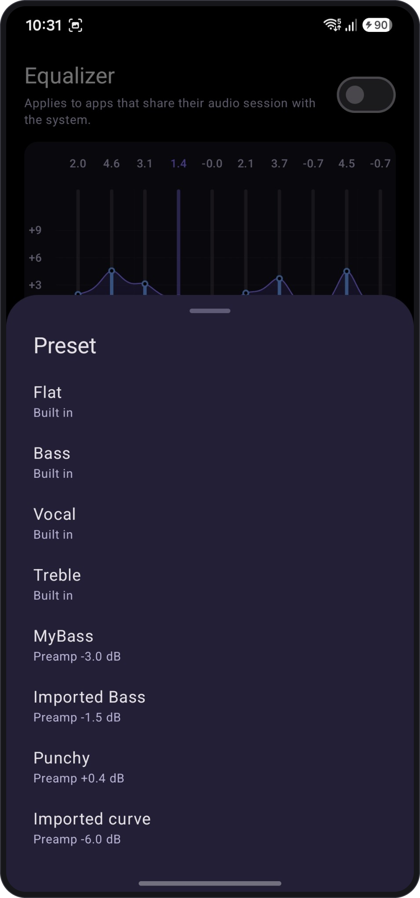
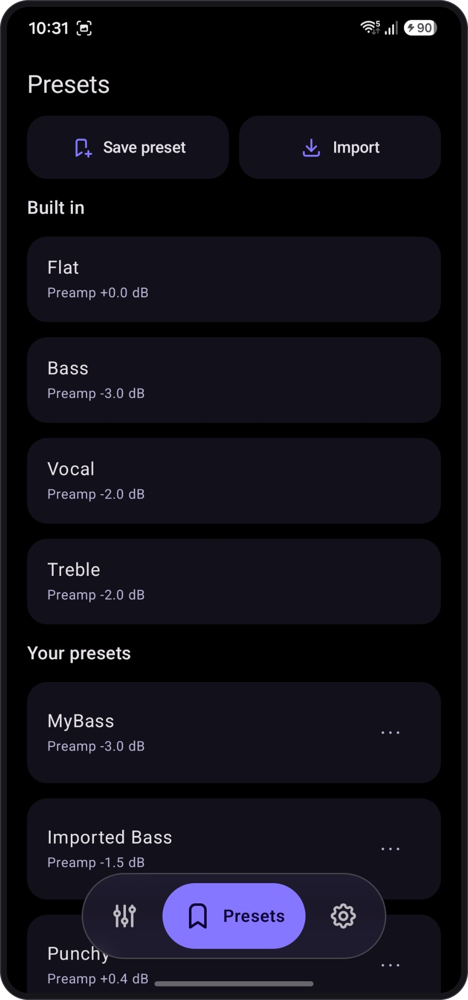
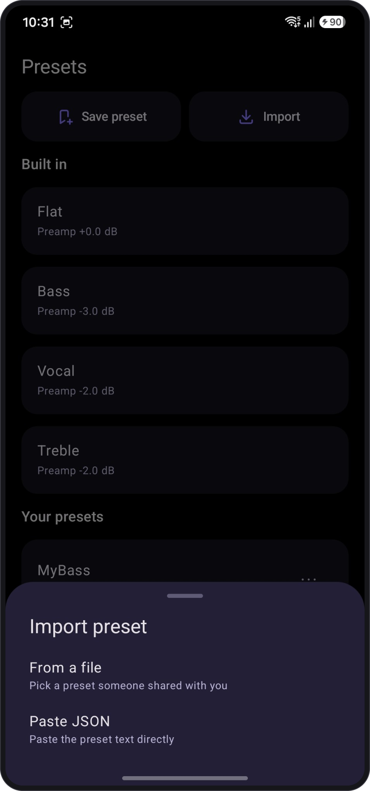
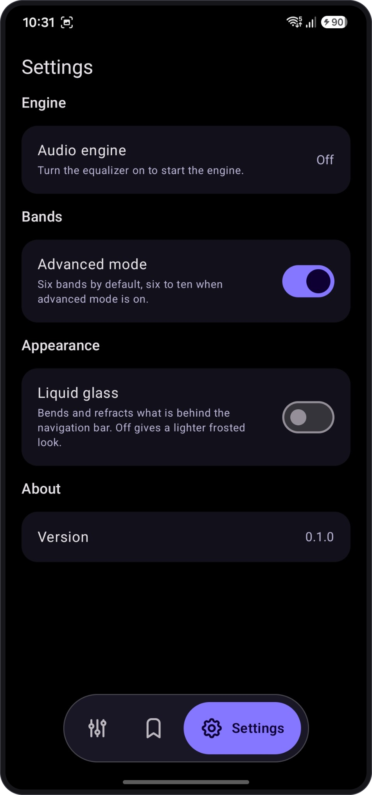

# PvotEqualizer

An equalizer for Android, on the [Pvot](https://github.com/PVOT-OSS) design system.

You shape a frequency curve directly: drag a band up or down, or fine-tune it in the band editor.
Six bands by default, ten in advanced mode. The same curve is what the audio engine applies, so
what you see is what you hear.

## Screenshots

<p align="center">
  
  &nbsp;
  
  &nbsp;
  
</p>
<p align="center">
  
  &nbsp;
  
  &nbsp;
  
</p>

## Status

Early, but usable. What works today:

- **Curve editor** with a preamp, a clipping warning and one-tap auto preamp.
- **Simple and advanced modes**: 6 or 10 bands, each keeping its own curve.
- **Presets**: built-in curves (Flat, Bass, Vocal, Treble), saving your own, and importing from a
  file or pasted text. Import reads PvotEqualizer JSON as well as AutoEQ `ParametricEQ.txt` and
  `GraphicEQ.txt`.
- **One-level undo** for deleting a preset, resetting the curve, applying a preset and zeroing a band.
- **Audio engine** on `DynamicsProcessing`, run from a foreground service with a Turn off action in
  its notification.

Not built yet: restoring the EQ after a reboot, a Quick Settings tile, and an all-apps mode.

## Design notes

- **A graphic EQ on a parametric model.** You only edit gain on fixed bands; underneath, each band
  is a biquad with a type, frequency and Q derived from its neighbours, so dragging one band only
  changes that part of the curve.
- **Honest fit.** `DynamicsProcessing` only takes cutoff/gain bands, so the curve is fitted onto up
  to 128 engine bands. Measured worst-case error is 0.14 dB for a typical six-band curve.
- **`dsp/` is pure Kotlin.** Biquad coefficients, magnitude response and the engine band fit have no
  `android.*` imports and are covered by JVM tests, because that maths decides whether the sound
  matches the screen.
- **Honest about coverage.** Android gives no rootless way to equalize every app. PvotEqualizer
  attaches to the audio sessions that apps hand to the standard effect-control broadcast, so players
  like Spotify and Poweramp work, while YouTube and Chrome are not affected. It does not sniff audio
  sessions through `dumpsys`.
- **No `INTERNET`, no analytics, no crash reporting, no microphone.** Presets stay on the device.

## Building

```
git clone --recurse-submodules https://github.com/PVOT-OSS/PvotEqualizer
cd PvotEqualizer
export ANDROID_HOME=$HOME/Library/Android/sdk
./gradlew :app:assembleDebug
```

JDK 21, Android SDK 37.1. The design system is the `PvotLib/` submodule, built as an included build.

## Licence

GPL-3.0. See [LICENSE](LICENSE) and [THIRD_PARTY_NOTICES.md](THIRD_PARTY_NOTICES.md).
